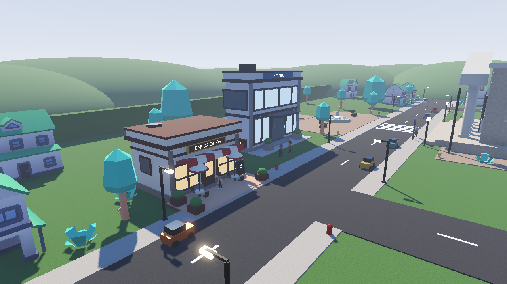
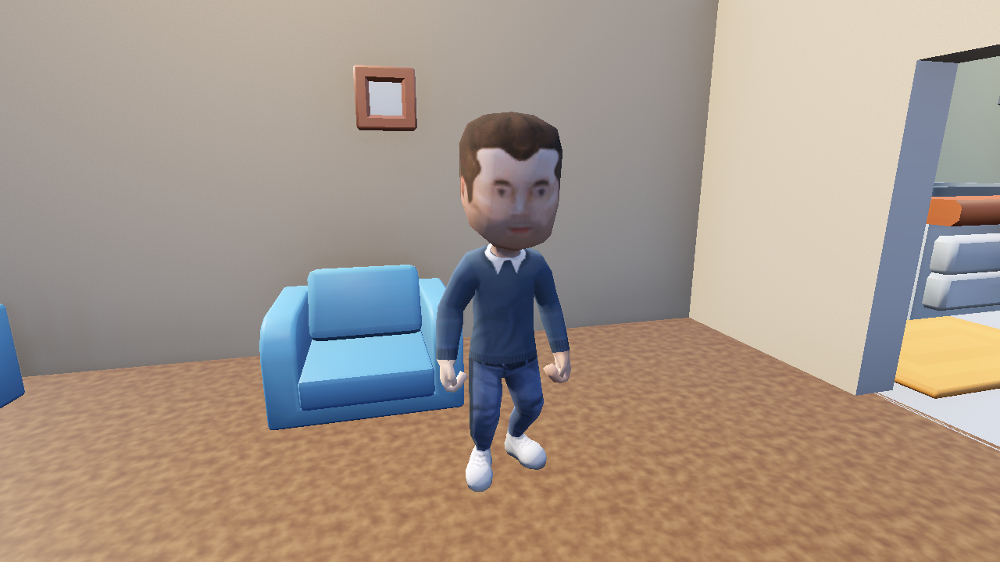
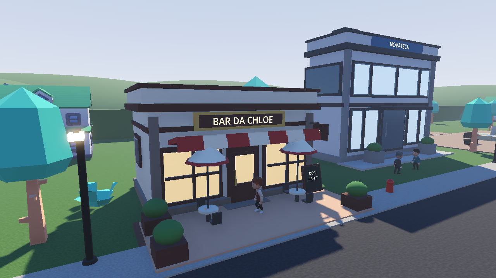
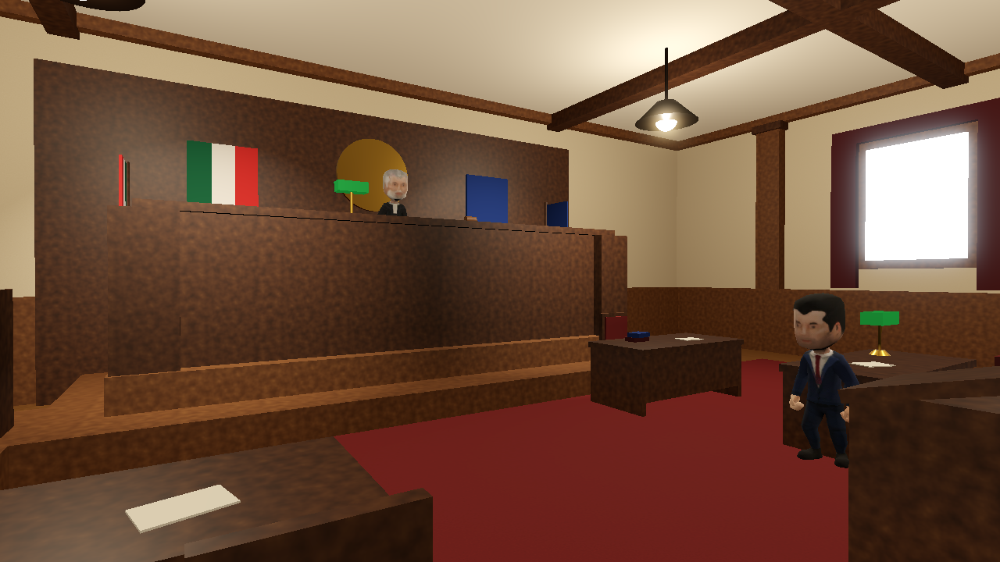
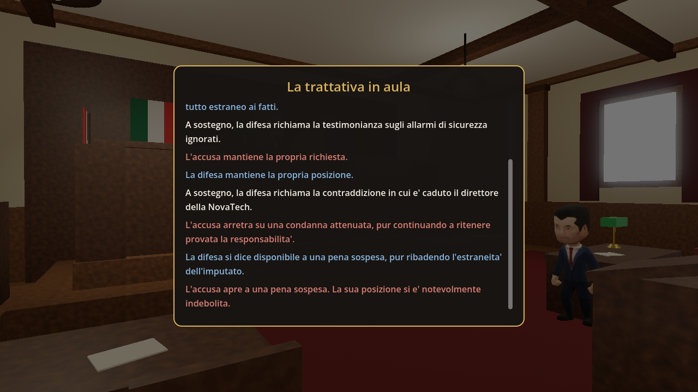

# My Friend Vesna: Beyond The Verdict

*My Friend Vesna: Beyond The Verdict* is an investigative adventure set in a world of characters that actually reason.



## The story

Bob has just moved into a new house when the servers of the company he works for are breached. The
trail leads straight to him. You are the lawyer assigned to defend him, but Bob doesn't trust you, and
the truth has to be earned before you can take it to court.

*My Friend Vesna* is split into three acts, each one a 3D environment explored in first person:

| Act | Where | What you do |
|---|---|---|
| **1 — The house** | Bob's house | Earn his trust by talking to him, listening to him and respecting his space, until he tells you what he remembers about that night |
| **2 — The town** | Streets, neighbours, colleagues | Gather evidence and testimony; people speak differently depending on who is standing next to them, and rumours pass from one to another |
| **3 — The courthouse** | The courtroom | The verdict isn't scripted: it comes out of a real negotiation between the prosecution and defence agents, based on the evidence you bring and how you answer in court |

The full story, act by act, is in [`vesna-light/docs/story.md`](vesna-light/docs/story.md).

The game's text is in Italian.

## A look at the game world

<table>
<tr>
<td width="50%">

**Bob's house**



</td>
<td width="50%">

**The town**



</td>
</tr>
<tr>
<td width="50%">

**The courthouse**



</td>
<td width="50%">

**The negotiation**



</td>
</tr>
</table>

More screenshots are in [`vesna-light/docs/immagini/`](vesna-light/docs/immagini/).

## What makes it different

The characters don't follow a fixed script: they are **BDI agents** (Belief-Desire-Intention) built
with [JaCaMo](https://jacamo-lang.github.io/) (Jason + CArtAgO + Moise), the same family of frameworks
used in multi-agent systems research. Each character has its own beliefs about what it knows and what
it wants, and reasons on its own about how to behave in the 3D environment. The environment is built in
**Godot 4** and connected to the agents' minds through **VEsNA**, the framework that bridges the two
worlds over WebSocket.

This means, for example, that in Act 2 two characters can avoid saying certain things when they are in
the same place (an employee won't complain about her boss while the boss is standing there), and that
the outcome of the trial in Act 3 comes out of a real negotiation between agents, not from a
hand-written `if`.

## Project status

- **Act 1 (house)** — playable: Bob's trust, interactions, an honest path and a sneaky one
- **Act 2 (town)** — playable: five characters, five pieces of evidence (the sixth comes from Act 1), mutual presence and rumours passed between agents
- **Act 3 (courthouse)** — playable: interactive hearing, automatic negotiation between prosecution and defence, end-of-game screen

## Repository structure

```
MyFriendVesna/
├── README.md                    this file
└── vesna-light/
    ├── README.md                technical documentation of the VEsNA framework
    ├── docs/
    │   ├── story.md             the story, act by act
    │   └── immagini/            screenshots and previews
    ├── mind/                    the "mind": JaCaMo agents (Jason/CArtAgO/Moise)
    │   ├── vesna.jcm            list of agents and their ports
    │   ├── src/agt/             one .asl file per agent
    │   │   ├── negoziazione/    the three layers of the negotiation protocol (Act 3)
    │   │   └── playgrounds/     maps of the environments
    │   └── banco_negoziazione/  test bench for the protocol, runs without Godot
    └── env/home/                the "body": Godot 4 project
        ├── project.godot
        ├── scenes/              main, home, city, courtroom_interior, bob
        ├── scripts/
        │   ├── agenti/          vesna.gd: the body of every agent
        │   ├── ui/              dialogue, inventory, negotiation log, end screen
        │   ├── sensori/         areas and objects that react to the player
        │   └── mondo/           radio, walls, town setup
        ├── menu/                main menu, pause, intro
        ├── data/                dialogue button texts
        ├── assets/              models, textures, audio, character skins
        └── addons/              third-party packages (Kenney, first person, room creator)
```

## Getting started

The project requires Java 23, Gradle and Godot 4. Full technical instructions (how to connect mind
and body, how to start the environment and the agents) are in
[`vesna-light/README.md`](vesna-light/README.md).
