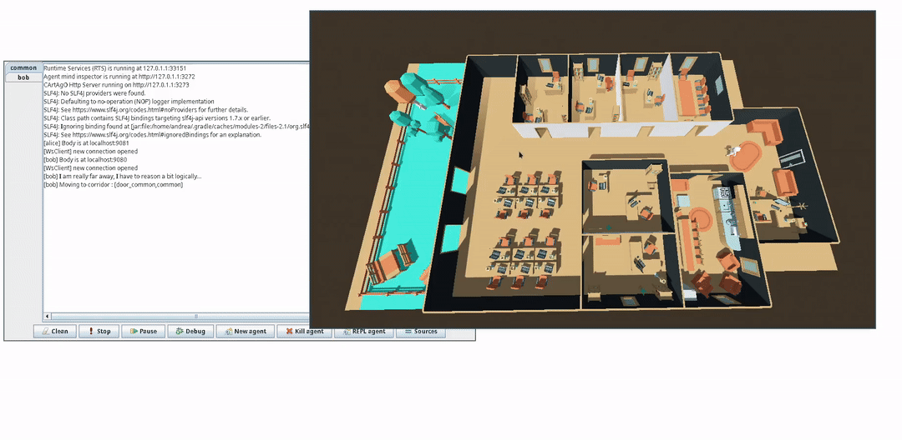

# VEsNA-light

VEsNA is a framework that enables JaCaMo agents to be embodied inside a virtual environment. This repository contains the bridge between agent minds and agent bodies.



## Usage

> [!IMPORTANT]
>
> **Requirements**
>
> - Java  23 (if you change version remember to change it in the `build.gradle` file);
> - Gradle (tested with version 8);
> - Godot 4.

The framework provides:

- a total new set of actions for spatial reasoning;
- a fully working playground environment implemented in Godot.

### Making a VEsNA agent on JaCaMo

In your `.jcm` file insert the new agent:

```
mas your_mas {
	
	agent bob:bob.asl {
		beliefs:	address( localhost )
					port( 9080 )
		ag-class:	vesna.VesnaAgent
	}

}
```

The new Agent class `VesnaAgent` creates a connection between each agent and its body. The body implements a server with an address and a port, the agent should place these two data inside the beliefs.

Inside your agent file you should include the `vesna.asl` file and, if you want, the playground files:

```
include{ ( "vesna.asl" ) }
include{ ( "playgrounds/office.asl" ) }
```

The vesna file provides plans:

- `go_to( Target )`: makes the agent move to the target;
- `follow_path( [ Path ] )`: makes the agent follow a path.

These plans make the agent reason with Region Connection Calculus (RCC). A map of the environment in RCC is given in the playground folder.

Additionally, the vesna agent has three new `DefaultInternalAction`s:

- `vesna.walk()`: can be used with different parameters.
  - without parameters: makes a step;
  - with a number `n`: makes a step of length n;
  - with a literal `target`: moves to the target;
  - with a literal `target` and a number `id`: moves to the target with id.
- `vesna.rotate()`: can be used with different parameters.
  - with a direction (`left`, `right`, `backward`, `forward`) to rotate in that direction;
  - with a literal `target` to look at target;
  - with a literal `target` and an `id` to look at target with id.
- `vesna.jump()`: makes a jump.

### Making the VEsNA agent body

To implement your VEsNA body you should implement a websocket Server. The server will receive these messages:

```json
{
    sender: "ag_name",
    receiver: "body",
    type: "msg_type",
    data: {
        type: "inner_type",
        ...
    }
}
```

The `sender` is set to the agent name in the mas. `msg_type` can be `walk`, `rotate` or `jump`. The `inner_type` is the inner type of the action.

Jump action has an empty data field.

#### Walk message data

A walk message can have two types: `goto` or `step`.

The data field for `goto` is:

```json
{
 	type: "goto",
    target: "target",
    id: 0 [optional]
}
```

The data field for `step` is:

``` json
{
    type: "step",
    length: 2 [optional]
}
```

#### Rotate message data

A rotate message can have two types: `direction` or `lookat`.

The data field for `direction` is:

```json
{
    type: "direction",
    direction: "left"
}
```

The data field for `lookat` is:

``` json
{
    type: "lookat",
    target: "target",
    id: 0 [optional]
}
```

### Try the playground

In order to try the playground, you should:

1. open Godot and import the playground you want;
2. start the main scene;
3. go in the mind folder;
4. launch the project (with `gradle run`).